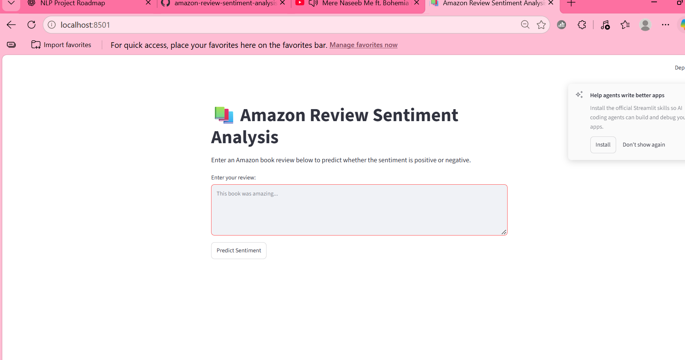
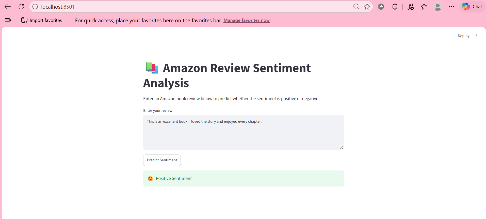
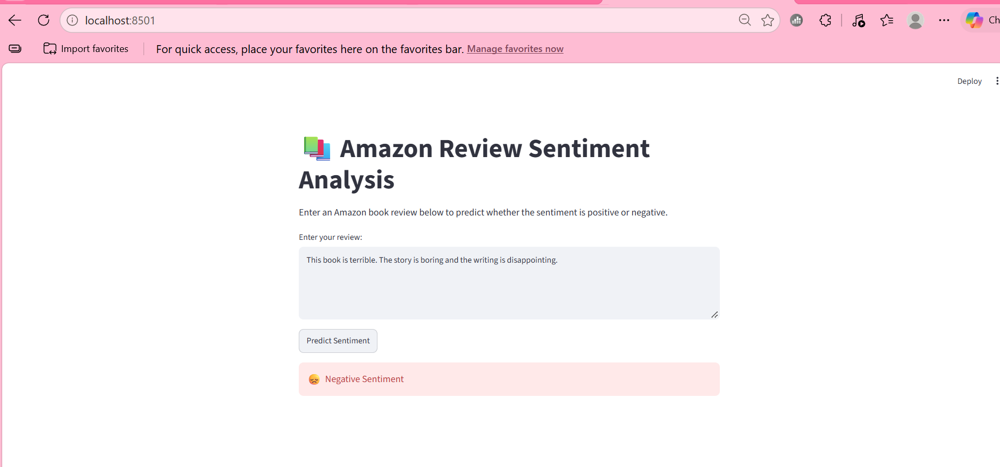
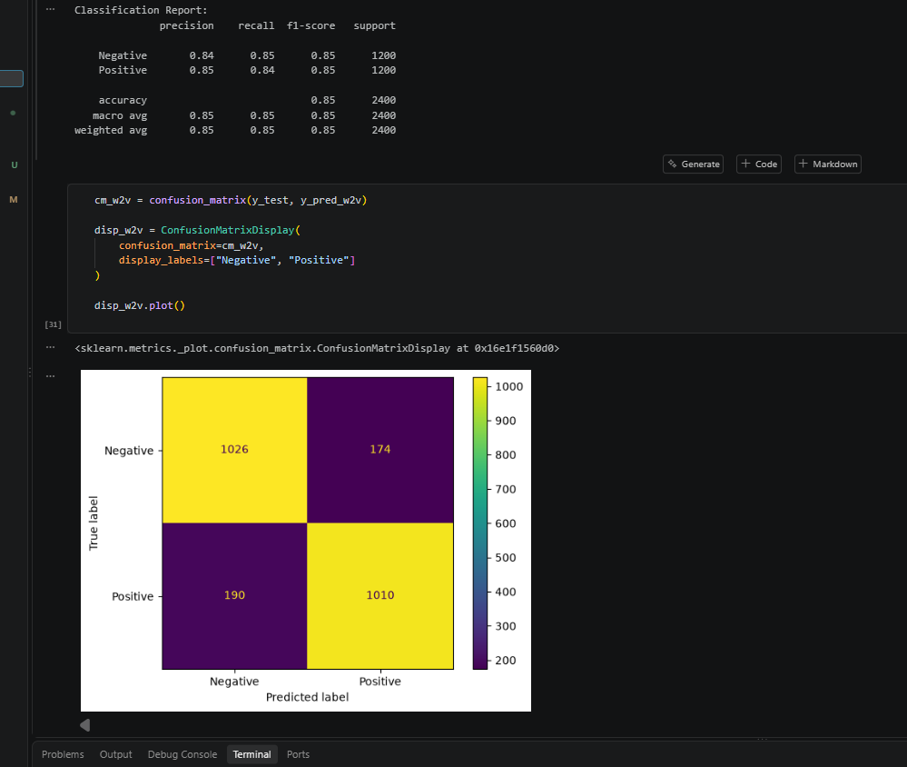

# Amazon Review Sentiment Analysis

An end-to-end Natural Language Processing (NLP) project that classifies Amazon book reviews as **Positive** or **Negative** using TF-IDF, Word2Vec, and Logistic Regression. The application provides a REST API using FastAPI and an interactive web interface using Streamlit.

## Project Overview

This project analyzes customer reviews to identify their sentiment automatically. It includes text preprocessing, feature extraction, model training, evaluation, prediction, and application development.

The trained model is integrated with a FastAPI backend and a Streamlit frontend, allowing users to enter reviews and receive sentiment predictions.

## Key Features

- Text preprocessing using NLTK and BeautifulSoup.
- HTML and URL removal, tokenization, stopword removal, and lemmatization.
- Feature extraction using TF-IDF and Word2Vec.
- Comparison of Logistic Regression models using different text representations.
- Model training and evaluation using Scikit-learn.
- Reusable prediction pipeline saved using Joblib.
- REST API development using FastAPI.
- Interactive frontend using Streamlit.
- Input validation and error handling.

## Tech Stack

| Category | Technologies |
|---|---|
| Language | Python |
| Data Processing | Pandas, NumPy |
| NLP | NLTK, Gensim, BeautifulSoup |
| Feature Extraction | TF-IDF, Word2Vec |
| Machine Learning | Scikit-learn, Logistic Regression |
| Model Serialization | Joblib |
| Backend | FastAPI |
| Frontend | Streamlit |
| Development | Jupyter Notebook, VS Code |
| Version Control | Git, GitHub |

## Dataset

**Dataset:** Amazon Kindle Book Reviews

The dataset contains approximately 12,000 records with review-related information, including ratings, review text, and summaries.

The rating column is converted into binary sentiment labels:

| Rating | Sentiment | Label |
|---|---|---|
| 1, 2, 3 | Negative / Non-positive | 0 |
| 4, 5 | Positive | 1 |

The review summary and review text are combined to create the input text for sentiment classification.

## Project Workflow

1. Data loading and exploratory data analysis.
2. Missing-value handling and text combination.
3. Sentiment label creation.
4. Text preprocessing and cleaning.
5. Train-test splitting using stratification.
6. Feature extraction using TF-IDF and Word2Vec.
7. Logistic Regression model training.
8. Model evaluation and comparison.
9. Saving the trained pipeline.
10. Building the prediction module.
11. Integrating the model with FastAPI.
12. Developing the Streamlit frontend.

## Model Performance

The dataset was split into 80% training data and 20% testing data.

| Model | Test Accuracy |
|---|---:|
| TF-IDF + Logistic Regression | 85.08% |
| Word2Vec + Logistic Regression | 84.83% |

**Selected Model:** TF-IDF + Logistic Regression

TF-IDF performed slightly better on the current train-test split, so it was selected for the final prediction pipeline.

## Application Architecture

The application follows a modular architecture:

```text
                 User
                   |
                   v
          Streamlit Frontend
               app.py
                   |
                   | HTTP POST
                   v
           FastAPI Backend
             backend/main.py
                   |
                   v
           Prediction Module
          src/prediction/predict.py
                   |
                   v
            Saved ML Pipeline
       TF-IDF + Logistic Regression
                   |
                   v
           Sentiment Prediction
            Positive / Negative
```

## Project Structure

```text
amazon-review-sentiment-analysis/
│
├── Dataset/
│   └── all_kindle_review.csv
│
├── notebooks/
│   └── amazon-sentiment-analysis.ipynb
│
├── models/
│   └── sentiment_pipeline.pkl
│
├── screenshots/
│   ├── confusion_matrix.png
│   ├── negative_review.png
│   ├── positive_review.png
│   └── streamlit_interface.png
│
├── src/
│   ├── common/
│   │   └── preprocessing_util.py
│   │
│   ├── training/
│   │   ├── config/
│   │   │   ├── settings.py
│   │   │   └── hyperparameters.yaml
│   │   └── sentiment.py
│   │
│   └── prediction/
│       └── predict.py
│
├── backend/
│   └── main.py
│
├── app.py
├── requirements.txt
├── .gitignore
└── README.md
```

## Application Screenshots

### 1. Streamlit Application



### 2. Positive Sentiment Prediction



### 3. Negative Sentiment Prediction



### 4. Model Evaluation



## Installation and Setup

### 1. Clone the repository

```bash
git clone https://github.com/hammadhussain0811-crypto/amazon-review-sentiment-analysis.git
cd amazon-review-sentiment-analysis
```

### 2. Create a virtual environment

```bash
python -m venv .venv
```

Activate it on Windows:

```powershell
.\.venv\Scripts\Activate.ps1
```

### 3. Install dependencies

```bash
python -m pip install -r requirements.txt
```

### 4. Configure environment variables

Create a `.env` file in the project root using the variables required by `src/training/config/settings.py`.

The `.env` file is intentionally excluded from GitHub.

### 5. Download NLTK resources

Run:

```python
import nltk

nltk.download("punkt")
nltk.download("punkt_tab")
nltk.download("stopwords")
nltk.download("wordnet")
nltk.download("omw-1.4")
```

### 6. Run the Streamlit frontend

Start the FastAPI backend in the first terminal:

```bash
python -m uvicorn backend.main:app --reload
```

Start Streamlit in a second terminal:

```bash
streamlit run app.py
```

Open the application at:

`http://localhost:8501`

FastAPI documentation is available at:

`http://127.0.0.1:8000/docs`

## API Endpoint

**Endpoint:** `POST /predict`

Example request:

```json
{
  "review": "This book was amazing. I really enjoyed reading it."
}
```

Example response:

```json
{
  "review": "This book was amazing. I really enjoyed reading it.",
  "sentiment": "Positive"
}
```

## Future Improvements

- Docker containerization.
- Cloud deployment of the frontend and backend.
- Prediction history and analytics.
- More advanced model experimentation.
- Improved input validation and monitoring.

**Created By-Hammad Hussain**

B.Tech | Artificial Intelligence and Machine Learning

GitHub: [Your GitHub Profile](https://github.com/hammadhussain0811-crypto)

---

*This project was developed as an end-to-end NLP and machine learning application, covering experimentation, model development, API integration, and frontend development.*
